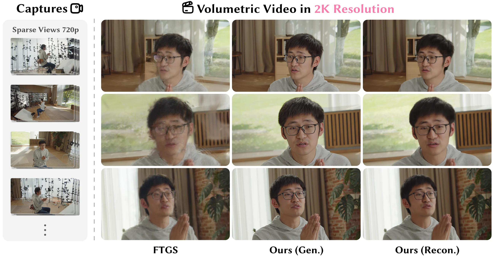
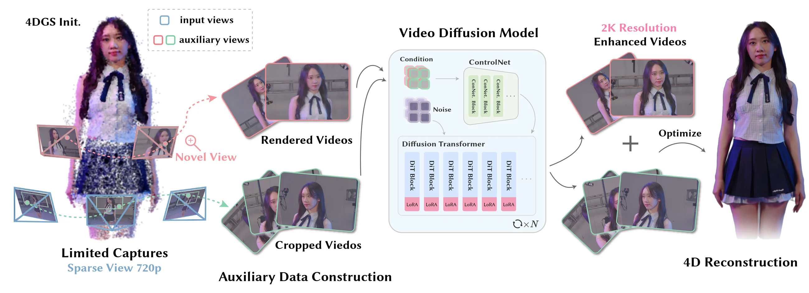

<p align="center"></p>

---

<div align="center">

<h1>RealMe: Immersive Volumetric Video from Minimal Captures</h1>

<p>
<a href="https://zicx.top/"><strong>Chenxu Zhou</strong><sup>1</sup></a> ·
<a href="https://fishfishson.github.io/"><strong>Zhiyuan Yu</strong><sup>1,†</sup></a> ·
<a href="https://krahets.com/"><strong>Yudong Jin</strong><sup>1</sup></a> ·
<a href="https://stland-admin.github.io/"><strong>Yinji Shentu</strong><sup>1</sup></a><br>
<a href="https://cn.linkedin.com/in/yu-zhang-4388aa336"><strong>Yu Zhang</strong><sup>2</sup></a> ·
<a href="https://jiamingsun.me/"><strong>Jiaming Sun</strong><sup>2</sup></a> ·
<a href="https://xzhou.me/"><strong>Xiaowei Zhou</strong><sup>1</sup></a>
</p>

<p><sup>1</sup> State Key Laboratory of CAD&amp;CG, Zhejiang University · <sup>2</sup> 4DV.ai<br>
<sup>†</sup> Corresponding author</p>

<p>SIGGRAPH Asia 2026</p>

<p>
<a href="https://arxiv.org/abs/2610.30023"></a>
<a href="https://zju3dv.github.io/realme/"></a>
<a href="https://github.com/zju3dv/RealMe"></a>

</p>

</div>



## 📜 News

- **2026:** RealMe was accepted to SIGGRAPH Asia 2026. The [paper](https://arxiv.org/abs/2610.30023) and [project page](https://zju3dv.github.io/realme/) are available.

## ⚒️ Method

RealMe creates immersive volumetric video from sparse, low-resolution multi-view captures. It builds a coarse 4D representation and derives auxiliary videos from novel-view renders and input crops. A high-resolution video diffusion model uses these videos to generate 2K, 4D-consistent enhanced views, which are combined with the original captures to refine the final 4D representation.



## 📝 Citation

If you find this code useful for your research, please use the following BibTeX entry.

```bibtex
@inproceedings{zhou2026realme,
  title     = {RealMe: Immersive Volumetric Video from Minimal Captures},
  author    = {Zhou, Chenxu and Yu, Zhiyuan and Jin, Yudong and Shentu, Yinji and Zhang, Yu and Sun, Jiaming and Zhou, Xiaowei},
  booktitle = {SIGGRAPH Asia 2026 Conference Papers},
  year      = {2026},
  doi       = {10.1145/3829340.3842349}
}
```

## 💌 Contact

If you have any question, please feel free to contact [Chenxu Zhou](mailto:cxzhou35@zju.edu.cn) or [Github issues](https://github.com/zju3dv/RealMe/issues).
